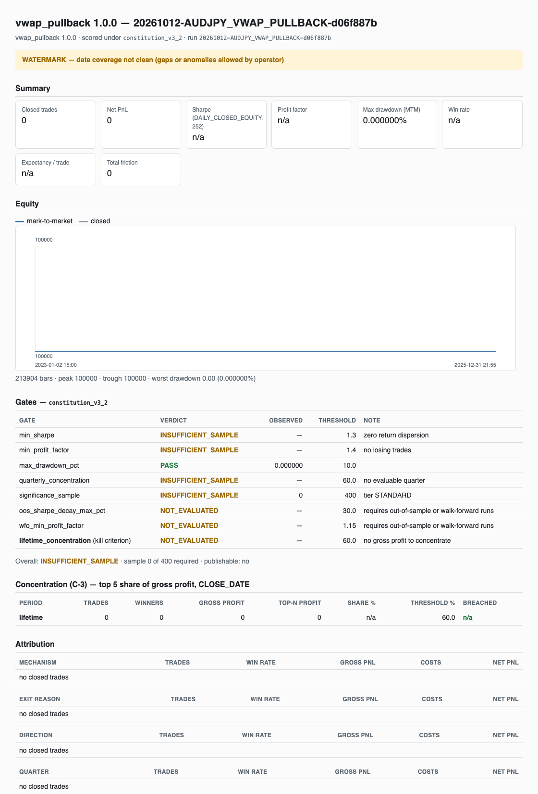

# QTROS: a backtesting system built to catch its own mistakes

QTROS (Quantitative Trading Research OS) is a Python system for testing trading ideas
against historical market data. It answers one question: *if I had followed this
rule in the past, what would have happened?* It is designed to make the common ways
backtests produce believable but wrong answers either impossible or loud.

It currently trades one currency pair (Australian dollar / Japanese yen, AUD/JPY) on
five-minute bars, with one reference strategy.

**Status in one paragraph.** The full pipeline works end to end: raw vendor files are
loaded, checked for quality, turned into indicators, run through a simulated broker
and a risk engine, reconciled exactly, scored against written pass/fail rules,
and saved as a reproducible report. It has been run once on three years of real
AUD/JPY data. **That run produced zero trades**, because the free data I have contains
no trading volume and the reference strategy depends on a volume-weighted price, which
the system refuses to make up. No performance results exist yet. Details are under
[Current status](#current-status).

---

## Why I built it

Before this project I backtested an AUD/JPY trading idea as a single Python script,
translated from a TradingView strategy and run on 2023–2025 one-minute data. The
numbers looked reasonable. The design notes in this repository record what went wrong
in that first round, which the code calls "Cycle 1":

- Partial exits changed the account balance without being recorded as trades, so the
  trade log and the balance disagreed.
- A data file's time zone was guessed instead of declared, and daylight-saving changes
  shifted session times. One of these cost an evening of debugging.
- The same idea that looked profitable on five-minute bars lost money on fifteen-minute
  bars, so the bar interval had to be treated as part of a strategy's identity.

None of those mistakes crashed anything. They produced plausible numbers. I wanted a
system where each of those failure types is either structurally impossible or stops
the run with an error, so that a good-looking result has earned some trust.

---

## The rules it enforces

Each rule below is enforced by code, not by convention. File paths are under
`src/qtros/`.

### 1. No looking into the future

A decision made at the close of bar *T* can see bar *T*'s prices, but every indicator
it reads was computed only through bar *T − 1*. The resulting order fills at the
**open of bar *T + 1***, never at the price the decision was based on.

| What | Where |
|---|---|
| Indicators are read from the previous row; the one-bar lag is a single named constant | `engine/context.py` → `BarContextFactory.feature_row_for`, `AVAILABILITY_LAG_BARS` |
| A data frame that was already shifted is refused, so features can't silently become two bars stale | `engine/context.py` → `BarContextFactory._guard_shift` |
| A data frame that hasn't passed the look-ahead audit is refused | `engine/context.py` → `BarContextFactory._guard_audit` |
| The audit recomputes every indicator on shortened history and fails if any past value changes | `features/lag_audit.py` → `LagAuditor.audit` |
| The audit is itself tested against a deliberately cheating indicator and must catch it | `features/lag_audit.py` → `verify_detector`; `tests/test_lag_audit.py` |
| A strategy may only read indicators produced by a registered, audited transform | `alpha/base.py` → `verify_feature_provenance` |
| Orders fill at the next bar's open; no decision is taken on the final bar | `execution/broker.py` → `SimulatedBroker._reference_price`; `engine/context.py` → `BarContextFactory.last_decision_index` |

### 2. Realistic trading costs

Every fill pays half the bid–ask spread, slippage that always works against the
trader, and commission. Each cost is recorded separately so you can see which one
killed an idea.

| What | Where |
|---|---|
| Negative slippage is refused; turning all costs off requires an explicit acknowledgement flag | `execution/friction.py` → `StandardFrictionModel.__post_init__` |
| Fill prices are moved against the trader and rounded to the price grid against the trader | `execution/broker.py` → `SimulatedBroker._apply_adverse_adjustment`; `domain/instrument.py` → `InstrumentSpec.round_price` |
| Spread and slippage costs are measured from the price actually received, not the price intended | `execution/broker.py` → `SimulatedBroker._derive_implicit_costs` |

### 3. Exact accounting

All money is stored as exact decimals, rounded to the nearest 0.01 of the quote
currency with banker's rounding. Cash can change only by booking a recorded fill. At
the end of every run, the sum of every fill's cash change must equal the change in the
account balance **exactly**. A difference of 0.01 yen fails the run.

| What | Where |
|---|---|
| Every value is rounded before it is stored; split costs add back to the original exactly | `domain/money.py` → `quantize_money`, `apportion` |
| The single function that moves cash | `engine/portfolio.py` → `Portfolio._book` |
| Each fill checks its own accounting identity | `domain/execution.py` → `ExecutionFill.assert_internally_consistent` |
| End-of-run reconciliation with zero tolerance; the run raises if it fails | `engine/portfolio.py` → `Portfolio.reconcile`; `engine/backtester.py` → `Backtester.run` |
| Config files reject floating-point numbers for money, so precision can't be lost when a file is read | `configuration/models/base.py` → `reject_float_input` |

### 4. Drawdown is measured at the worst price inside each bar

Drawdown is the drop from the account's highest value. A bar's closing price can hide
how bad it got during the bar. After each bar, the risk engine values any open
position at the bar's **low** (for a long position) or **high** (for a short one).
That is the number a funded trading account would be judged on. If the drop from the
peak reaches the limit (10% in the current config), new trades are blocked. Exits are
still allowed, so an open position can always be closed.

| What | Where |
|---|---|
| Worst intrabar value of the account | `risk/engine.py` → `RiskEngine.adverse_extreme` |
| Measured against the peak *before* the bar, then the peak is updated | `risk/engine.py` → `RiskEngine.on_bar_close` |
| New entries refused while halted; exits always allowed | `risk/engine.py` → `RiskEngine._approve_entry`, `RiskEngine._approve_exit` |

### Other safeguards

- **When one bar touches both the stop and the target, the stop wins.** Price data
  can't say which came first, so the system assumes the worse case. If price gaps past
  a stop, the fill is at that bar's opening price, not the stop price.
  `execution/broker.py` → `SimulatedBroker.resolve_protective_exit`, `SimulatedBroker._stop_trigger`.
- **Every order must pass the risk engine.** An approved order can't be constructed
  without a token that only the risk engine uses.
  `domain/orders.py` → `ApprovedOrder.__post_init__`; `risk/engine.py` → `RiskEngine._mint`;
  checked by `tests/test_risk.py::TestApprovalTokenIsConfinedToRisk`.
- **Position size limits reject, never shrink.** A hard maximum lot size and a cap on
  total exposure as a multiple of the account. An order over either limit is refused,
  not resized. `risk/limits.py` → `MaxLotRule`, `MaxNotionalExposureRule`.
- **Bad data stops the run.** Missing bars, duplicates, or impossible prices refuse
  the run unless the operator overrides it. An override stamps the result as not
  publishable. Ambiguous daylight-saving timestamps raise an error instead of being
  guessed. `workflow.py` → `load_bars`; `domain/timekeeping/calendar.py` → `localize`.
- **Results are reproducible.** Every run records a fingerprint of its configuration,
  a fingerprint of the exact data, and the code version. A run from uncommitted code
  is stamped untrusted. `configuration/hashing.py` → `compute_hashes`;
  `persistence/writer.py` → `RunWriter.write`.
- **Layers can't reach around each other.** For example, only one module may talk to
  the database. These rules are enforced by `import-linter` contracts in `pyproject.toml`.

---

## Install and run

Requires Python 3.11 or newer.

```bash
git clone https://github.com/sebastianO8/qtros.git
cd qtros
python3 -m venv .venv
source .venv/bin/activate
pip install -e ".[dev]"
```

**Check that everything works (no market data needed):**

```bash
pytest
qtros validate phase1_mvp
```

`validate` loads a run's configuration and prints its three fingerprints.

**Run on real data.** Market data is not included in this repository. It is large,
and it belongs to the vendor.

1. Download the free AUD/JPY **1-minute** "Generic ASCII" files for 2023, 2024, and
   2025 from [histdata.com](https://www.histdata.com/download-free-forex-data/).
2. Unzip them and put the three `DAT_ASCII_AUDJPY_M1_*.csv` files in
   `data_lake/raw/histdata_audjpy_m1/`.
3. Load them into the local database, then run:

```bash
qtros ingest histdata_audjpy_m1
qtros run histdata_audjpy_2023_2025 --allow-gaps
qtros registry
```

Each run writes `results/<run_id>/` with a manifest, the full trade and fill ledgers,
the scoring, and `report.html`. `qtros registry` rebuilds `docs/registry.md`, a table
of every run.

---

## Current status

### First real-data run (12 October 2026)

Run `20261012-AUDJPY_VWAP_PULLBACK-d06f887b`, from commit `65a724b`, on HistData.com
AUD/JPY one-minute data for 2023–2025. Artifacts are in
[`docs/first_real_run/`](docs/first_real_run/).

| Step | Result |
|---|---|
| Ingestion | 1,067,161 one-minute rows read, 0 rejected, aggregated to 214,089 five-minute bars |
| Data quality gate | **Refused the run.** 805 unexpected gaps, about 4.4% of expected bars missing. I confirmed in the raw vendor file that the holes are in the data itself, for example no rows from 12:00 to 14:59 on 7 July 2023. |
| Run with `--allow-gaps` | Completed and stamped **not publishable** |
| Look-ahead audit | Passed on all 5 indicator columns |
| Trades | **0.** The volume-weighted price (VWAP) was undefined on every bar because this data has no volume, so the strategy never got a signal |
| Reconciliation | Passed, 0 fills, 0.00 discrepancy |
| Gates | `INSUFFICIENT_SAMPLE`: 0 of the 400 trades required |



**This is the system working, not a strategy result.** Two safeguards fired on real
data: the data-quality gate refused incomplete data, and the indicator layer refused
to invent volume. The run says nothing about whether the strategy is any good.

Getting to this run found three problems:

1. **The vendor's documented time zone is wrong for these files.** HistData says its
   timestamps are Eastern Standard Time with no daylight saving. In fact five US jobs
   reports, released at 08:30 New York time, all spike at 08:30 on the file's clock,
   summer and winter alike. The files follow New York local time with daylight saving.
   Reading them as fixed EST would have put every summer bar an hour late. My first
   script made that same assumption. The source config now declares the right zone,
   and a test covers a summer and a winter bar.
2. **Any data source without volume had every row rejected.** This was a null-safety
   mistake in the bad-bar check. It is fixed, with regression tests in
   `tests/test_aggregation.py`.
3. **The data-quality gate could not see the time-zone error.** It checks for missing
   bars, not for bars that appear while the market is supposed to be closed. With the
   correct time zone, 287 bars fall in closed time, mostly thin Christmas Day trading.
   With the wrong one, 1,163 do. Adding that check is on the unfinished list.

### What works

- Loading vendor files with declared time zones, quality checks, and fingerprints;
  aggregation from one-minute to five-minute bars.
- Indicator pipeline with the look-ahead audit.
- Simulated broker with costs, stops, targets, and gap handling.
- Risk engine with sizing, exposure caps, and the drawdown halt.
- A deterministic run loop with exact reconciliation.
- Scoring: Sharpe ratio, drawdown, profit concentration in the top trades,
  attribution, and pass/fail gates.
- An HTML report, reproducible result folders, a registry of runs, and a command-line
  tool.
- 314 automated tests. Type checking (`mypy --strict`), linting (`ruff`), and layer
  contracts (`import-linter`) all pass.

### What is unfinished

- **No trades on real data yet.** The reference strategy needs volume data. A
  Dukascopy source configuration exists (`config/sources/dukascopy_m5.yaml`) but has
  not been tested against a real Dukascopy file.
- **The risk limits probably need tuning before the strategy can trade.** With 1% risk
  per trade and a 3× exposure cap, any entry whose stop is closer than about 0.33% of
  price would be refused. That is arithmetic, not a measured result.
- **Holiday calendar is incomplete.** It lists only 2024–2025 holidays, so Christmas
  2023 shows up as missing data.
- **No check for bars during closed hours.** That check would have caught the time-zone
  error described above.
- **Only one strategy.** The original AUD/JPY session strategy from the first script
  has not been ported.
- **No out-of-sample or walk-forward testing.** Those two gates are reported as
  `NOT_EVALUATED`.
- **Single instrument, single position, no margin model.**
- **Some design documents are missing.** Code comments refer to design rulings
  (ARCH-001, ARCH-003 to ARCH-007) and a project "constitution" that are not in the
  repository. ARCH-002, the assumptions register, and the automation plan are in
  `docs/`.

---

## How this was built

I designed and directed this project. AI coding agents wrote most of the code to my
specifications, and I used a separate AI model as a planning reviewer to draft and
critique design options. I made the final calls.

- **July–August 2026.** The agents drafted design documents laying out options and
  open questions, for example whether to fingerprint configuration as one hash or
  three, and how to keep config files from losing decimal precision. I approved or
  rejected each proposal. I copied each generated module into the repository, ran the
  test suite, and made the first eleven commits. `scripts/check_sources.py` exists
  because code arrived in pieces, and an outdated copy of one file could silently
  compute wrong answers.
- **October 2026.** I switched to an agent that edits the repository directly, working
  under a written operating plan I adopted
  ([`docs/plans/master_automation_plan.md`](docs/plans/master_automation_plan.md)).
  The plan requires every change to pass the full test, lint, and type-checking gate,
  and tells the agent to stop on any failure. It forbids changes to core accounting
  files without my approval and makes the agent pause for my review after each major
  module. I approved the design rulings it built against, for example measuring
  drawdown at the worst intrabar price, and blocking new trades but not exits after a
  drawdown halt. Commits from this phase carry a co-author line for the agent.

My work was setting the goals and constraints, deciding design questions as they came
up, and reviewing results. I did not write most of the code line by line.

---

## What I learned

- **Passing tests can still hide a wrong total.** An early version charged spread and
  slippage twice, once in the fill price and again as a cash fee. Every component test
  passed. A simple buy-and-hold benchmark with a hand-computed answer caught it: about
  8 basis points per round trip, enough to make good strategies look bad
  (`docs/validation/assumptions.md`, ASS-006).
- **"Exact" needs a limit on decimal places.** Python's decimals keep up to 28 digits
  after a division, and adding the same amounts in a different order can then round
  differently. A randomized property test found this, not any hand-written case
  (ASS-007).
- **Check documentation against the data.** The data vendor's stated time zone was
  wrong for these files, and so was my first script, which trusted it. Scheduled news
  releases give you a clock you can verify. Real data also exposed the missing-volume
  bug and 4.4% missing bars, which synthetic test data never would have.
- **The dangerous bugs produce believable numbers, not crashes.** Most of the system
  exists to turn silent errors into loud ones.
- **Directing AI agents is mostly specifying and checking.** The useful work was
  writing down rules precise enough to test, and building checks that make a broken
  change fail.

---

## Repository layout

```
config/            YAML configuration: instruments, calendar, data sources, features,
                   strategy, risk, costs, scoring rules, backtests
src/qtros/
  domain/          core types: money, bars, orders, fills, trades, calendar
  data/            the only door to files and the database: ingestion, quality, fingerprints
  features/        indicators and the look-ahead audit
  alpha/           strategies
  risk/            sizing, exposure caps, drawdown halt
  execution/       simulated broker and trading costs
  engine/          run loop, portfolio ledger, config-to-run builder
  analytics/       metrics, concentration, attribution, gates, HTML report
  persistence/     result folders and the run registry
  workflow.py      joins the layers end to end
  cli.py           the `qtros` command
tests/             automated tests
docs/              design document, assumptions register, automation plan, first run
```

## License

MIT. See [LICENSE](LICENSE).
